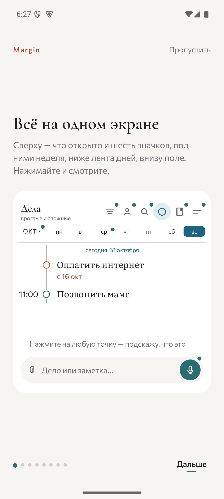
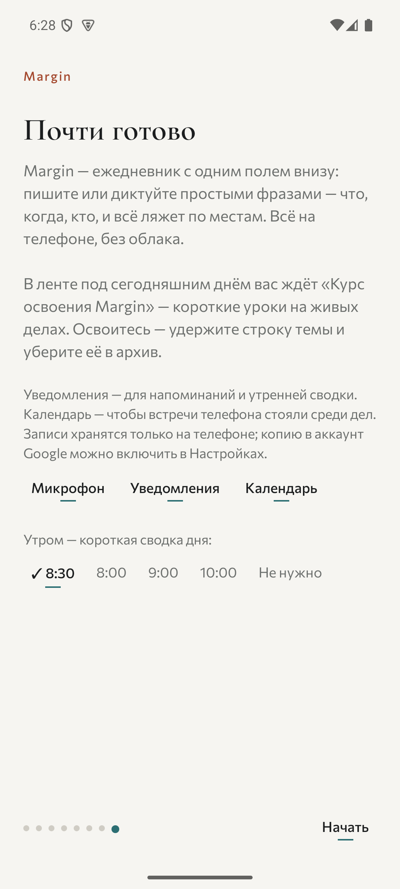
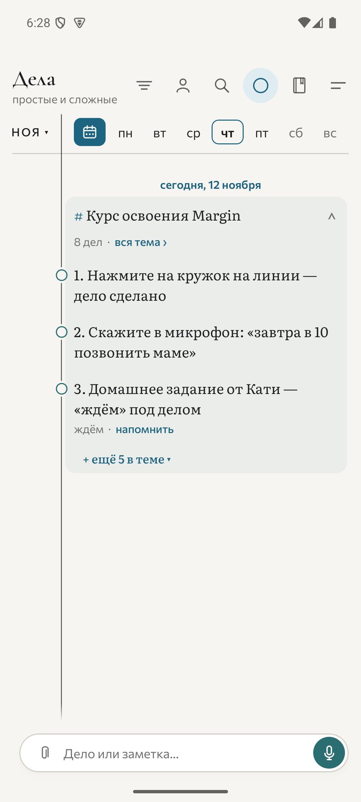
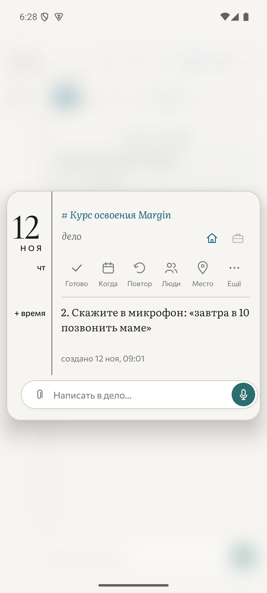
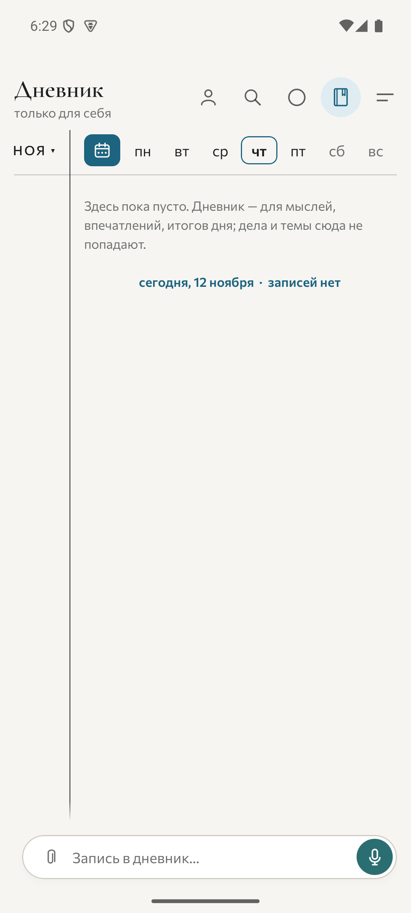
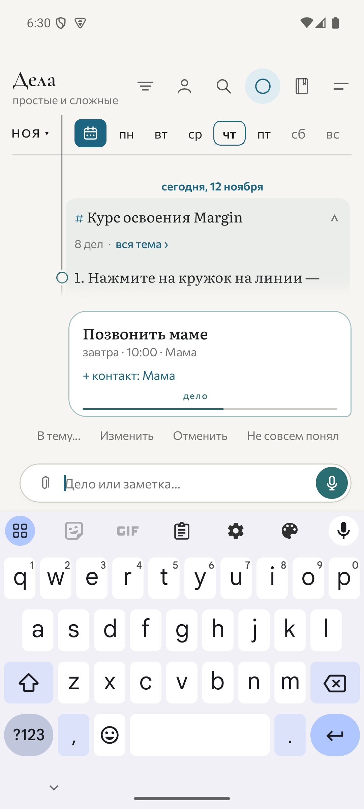
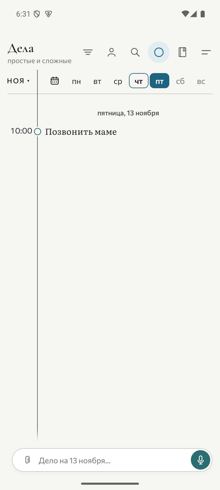

# Margin 0.103 — дизайн и юзабилити

Дата: 12 ноября 2026. Экспертная оценка по живой release-сборке 0.103 в существующем Android-эмуляторе margin35 (Android 15, снимки 1080×2400). Исходный код приложения не менялся. В эмулятор установлена release-сборка рядом с существующей debug-сборкой; пройдено знакомство и создано одно тестовое дело.

Общая оценка: визуальная система выразительная и цельная; основной риск — сложность освоения. Бумажный фон, характерная типографика, петрольный акцент и линия полей образуют узнаваемый интерфейс. Навигация и обучение требуют упрощения. Это экспертное суждение, а не результат пользовательского исследования.

## Проверенные шаги

### 1. Первый экран знакомства — выразительно, но высокая нагрузка

Заголовок хорошо читается, знакомство можно пропустить, макет интерактивен. Одновременно объясняются шесть значков, неделя, лента и поле. Внизу восемь индикаторов страниц: до первой собственной записи нужно усвоить много устройства приложения.

Рекомендация: сначала предложить создать одно дело; остальное объяснять при первом использовании.

### 2. Финальная настройка — понятно по смыслу, перегружено решениями

«Пропустить» приводит к финальной настройке. Здесь большой текст, микрофон, уведомления, календарь и выбор времени утренней сводки. Значение разрешений объяснено — это плюс. Момент запроса возможностей стоит приблизить к действию, ради которого они нужны.

Рекомендация: микрофон при первой диктовке, уведомления при первом напоминании, календарь при включении интеграции. Отдельно проверить, не воспринимают ли люди «Пропустить» как завершение знакомства.

### 3. Дела — сильный стиль, слабая обнаружимость навигации

Хорошо: читаемые названия, ясная линия времени, постоянное поле ввода, отдельные визуальные состояния текущего и выбранного дня. Слабее: шесть значков без видимых подписей; пустой круг как символ раздела «Дела» требует запоминания. Шкала показывает дни недели без чисел, точная дата видна только для выбранного дня.

Учебная тема сразу добавляет восемь дел. Это помогает пробовать интерфейс, но занимает рабочую ленту и смешивает обучение с обязательствами. На свежем экране показаны три учебных дела и ссылка на ещё пять.

Рекомендации: явно подписать «Дела» и «Дневник», обозначить режим всей недели текстом, добавить числа к дням. Курс сделать добровольным, с видимыми действиями «Начать» и «Убрать обучение».

### 4. Карточка дела — действия понятнее, иерархия спорная

Подписи «Готово», «Когда», «Повтор», «Люди», «Место», «Ещё» заметно облегчают понимание. Но название родительской темы и крупная дата стоят выше текста самого дела; настоящее содержание начинается под панелью действий. Первое чтение требует просмотреть служебную часть.

Рекомендация: сделать название дела первым смысловым элементом; тему показать тише; дату и действия расположить следом. Сохранить поля как узнаваемую деталь.

### 5. Пустой дневник — назначение ясно, начать можно проще

Поле меняет подсказку на «Запись в дневник…», что хорошо объясняет контекст. Пустота описана большим абзацем и повторным сообщением «записей нет». Прямого приглашения к первой записи мало.

Рекомендация: одна короткая подсказка «Что хочется запомнить сегодня?» и пример записи. Сократить объяснение границ раздела.

### 6. Создание дела — разбор понятен, результат перегружен действиями

Полная фраза «Завтра в 10 позвонить маме» передана через поддерживаемый ACTION_SEND в основное поле, затем нажата кнопка отправки. Самостоятельный набор кириллицы и диктовка не проверялись. Получено «Позвонить маме», завтра, 10:00, человек «Мама» — результат хорошо виден и соответствует фразе.

Над клавиатурой одновременно показаны карточка, предложение добавить контакт, индикатор времени и четыре действия: «В тему…», «Изменить», «Отменить», «Не совсем понял». Быстрое исчезновение требует успеть прочитать и выбрать действие. Конкретное время исчезновения в этом аудите не измерялось.

Рекомендация: выделить два основных действия «Изменить» и «Отменить»; остальные перенести в дополнительное меню. Возможность исправить результат должна оставаться доступной и после исчезновения блока.

### 7. Поиск результата в завтрашнем дне — успешно

После выбора пятницы дело отображается на 13 ноября в 10:00. Текст хорошо читается; время на полях работает особенно удачно. Подсказка поля «Дело на 13 ноября…» сообщает, что новая запись будет относиться к выбранному дню. Это полезная защита от ошибки контекста.

## Приоритеты

1. Подписать основные разделы и режим недели: это улучшит каждое посещение.
2. Сократить путь к первой собственной записи, сделать курс добровольным.
3. Упростить блок результата: исправление и отмена должны находиться быстро.
4. Переставить название дела выше служебных элементов в карточке.
5. Добавить числа к дням недели и сократить пустое состояние дневника.

## Доступность и пределы оценки

Крупный основной текст и подписи действий в карточке — сильные стороны. Маленькие визуальные кружки завершения и скрытые действия по удержанию требуют проверки на моторную доступность и обнаружимость; по размеру нарисованного кружка нельзя судить о размере области касания. В дереве интерфейса есть описания основных значков, но работа TalkBack не проверялась. Цвет не должен оставаться единственным способом отличать просрочку, ожидание и выбранное состояние.

Не проверялись: TalkBack, увеличенный системный шрифт, маленький экран, тёмная тема, реальный микрофон, полнота контраста по всем состояниям, длительное использование и большой объём данных. Выводы об этих условиях требуют отдельной проверки. Промежуточный снимок ввода 06-input.png и снимок старой debug-сборки 01-start.png не используются как доказательство текущего интерфейса.
